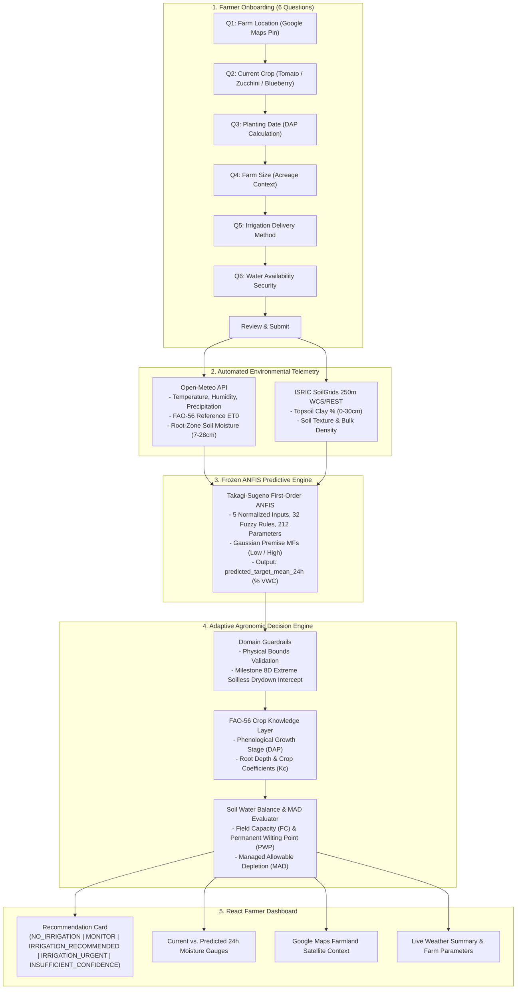

# 🌱 IrrigaSense: Precision Irrigation Advisory Platform

> **Adaptive Irrigation Prediction & Decision Support Using Neuro-Fuzzy Computing and Automated Geospatial Telemetry**

---

## 1. Problem Statement & Aim

Traditional precision agriculture systems often require invasive, costly in-situ soil sensor probes (capacitance/TDR sensors, dataloggers) or demand complex, manual mathematical calculations ($ET_0$, soil bulk density, depletion coefficients) that place an unrealistic burden on smallholder and commercial farmers.

**IrrigaSense** solves this challenge by eliminating hardware prerequisites and manual data entry. Through a frictionless **6-Question Farmer Assessment**, the platform automatically resolves high-resolution geospatial, meteorological, and pedological telemetry (via **Open-Meteo** and **ISRIC SoilGrids**), predicts 24-hour root-zone soil moisture using a **5-Input First-Order Takagi-Sugeno ANFIS (Adaptive Neuro-Fuzzy Inference System)**, and translates physical soil-water balances into clear, actionable, deterministic irrigation timing recommendations using an **FAO-56 Crop-Aware Decision Engine**.

---

## 2. System Architecture & End-to-End Pipeline



---

## 3. The Six Farmer Questions & Automated Telemetry

IrrigaSense strictly limits farmer input to 6 conversational, non-technical questions. All complex parameters are automated:

| Step | Farmer Input | Type | Value Handled / Automated Telemetry |
| :--- | :--- | :--- | :--- |
| **Q1** | **Farm Location** | Interactive Google Map Pin | Resolves exact latitude/longitude. Automatically queries **Open-Meteo** ($ET_0$, temperature, humidity, precipitation, root-zone moisture) and **ISRIC SoilGrids** (clay content %). |
| **Q2** | **Current Crop** | Visual Card Selector | Identifies crop species (e.g. *Tomato*, *Zucchini*, *Blueberry*). Maps to FAO-56 stage thresholds, root depth, and depletion tolerance ($p$). |
| **Q3** | **Planting Date** | Calendar Date Picker | Calculates **Days After Planting (DAP)** and dynamically transitions between Initial, Crop Development, Mid-Season, and Late-Season stages. |
| **Q4** | **Farm Size** | Radio Selection | Captures operational farm scale (`< 1 acre`, `1–2 acres`, `2–5 acres`, `> 5 acres`). |
| **Q5** | **Irrigation Method** | Radio Selection | Captures delivery context (`Drip`, `Sprinkler`, `Flood`, `Other`). |
| **Q6** | **Water Availability**| Radio Selection | Captures water security (`Abundant`, `Moderate`, `Limited`). |
| **Review** | **Summary Confirmation**| Review Screen | Allows reviewing answers before launching the Live Farmer Dashboard. |

---

## 4. Technology Stack

- **Backend:** Python 3.10+ (tested with Python 3.14), **FastAPI**, **Uvicorn**, **SQLAlchemy** (SQLite), **Pydantic v2**, **NumPy**, **httpx**.
- **Frontend:** **React 19**, **TypeScript**, **Vite**, Google Maps JavaScript API Loader (`@googlemaps/js-api-loader`), Vanilla CSS Design System.
- **Machine Learning / Neuro-Fuzzy:** Custom vectorized First-Order Takagi-Sugeno ANFIS with Gaussian premise membership functions, analytical log-sum-exp firing strength normalization, and linear consequent hyperplanes.
- **External Telemetry APIs:**
  - [Open-Meteo Weather & Soil Moisture Forecast API](https://open-meteo.com/) (Free, non-commercial open API).
  - [ISRIC SoilGrids 250m Global Soil Information](https://www.isric.org/explore/soilgrids) (REST / WCS endpoints).
  - [Google Maps JavaScript API & Places API](https://developers.google.com/maps).

---

## 5. Prerequisites & Local Installation

### Prerequisites
- **Python:** Version `3.10` or higher (tested with Python 3.14 on Windows/Linux/macOS).
- **Node.js:** Version `18.0.0` or higher (tested with Node.js v20/v24).
- **Git**

---

### Step 1: Clone the Repository

```bash
git clone https://github.com/Heramb101/IrrigaSense.git
cd IrrigaSense
```

---

### Step 2: Backend Setup

1. Navigate to the `backend/` directory:
   ```bash
   cd backend
   ```

2. Create and activate a Python virtual environment:
   - **Windows (PowerShell):**
     ```powershell
     python -m venv venv
     .\venv\Scripts\Activate.ps1
     ```
   - **Windows (Command Prompt):**
     ```cmd
     python -m venv venv
     venv\Scripts\activate.bat
     ```
   - **Linux / macOS:**
     ```bash
     python3 -m venv venv
     source venv/bin/activate
     ```

3. Install required Python packages:
   ```bash
   pip install -r requirements.txt
   ```

4. Configure backend environment variables:
   ```bash
   # Copy the example environment template
   cp .env.example .env
   ```

5. Initialize and seed the SQLite database:
   ```bash
   python setup_dev_db.py
   ```

---

### Step 3: Frontend Setup

1. Navigate to the `frontend/` directory (from the repository root):
   ```bash
   cd ../frontend
   ```

2. Install Node.js dependencies:
   ```bash
   npm install
   ```

3. Configure frontend environment variables:
   ```bash
   # Copy the example environment template
   cp .env.example .env
   ```
   Open `frontend/.env` and configure your Google Maps API Key:
   ```env
   VITE_GOOGLE_MAPS_API_KEY=your_google_maps_api_key_here
   VITE_API_URL=http://localhost:8000/api
   ```
   *(Note: If `VITE_GOOGLE_MAPS_API_KEY` is left blank, the frontend gracefully falls back to an interactive non-API location selector for development).*

---

## 6. Running the Application

### 1. Start the FastAPI Backend Server

From the `backend/` directory with the virtual environment activated:
```bash
uvicorn app.main:app --reload --host 127.0.0.1 --port 8000
```
- The backend API will be available at: `http://127.0.0.1:8000`
- Interactive OpenAPI / Swagger documentation: `http://127.0.0.1:8000/docs`
- Health check: `http://127.0.0.1:8000/health`

### 2. Start the Vite Frontend Development Server

In a separate terminal, navigate to the `frontend/` directory:
```bash
npm run dev
```
- The React application will be available at: `http://localhost:5173`

---

## 7. API Reference & Endpoint Examples

### Health Check
```bash
curl http://127.0.0.1:8000/health
```
**Response:**
```json
{"status": "healthy"}
```

---

### Adaptive Irrigation Recommendation
`POST /api/decision/recommendation`

**Example Request:**
```bash
curl -X POST http://127.0.0.1:8000/api/decision/recommendation \
  -H "Content-Type: application/json" \
  -d '{
    "crop_name": "Tomato",
    "planting_date": "2026-08-15",
    "latitude": 18.1550,
    "longitude": 74.5800,
    "farm_size": "2–5 acres",
    "irrigation_method": "Drip",
    "water_availability": "Moderate"
  }'
```

**Example Successful Response:**
```json
{
  "decision": "IRRIGATION_RECOMMENDED",
  "confidence": "HIGH",
  "current_moisture": 24.2,
  "predicted_moisture_24h": 21.8,
  "field_capacity": 32.0,
  "mad_threshold": 24.8,
  "depletion_fraction": 0.56,
  "moisture_state": "DEFICIT",
  "crop": "Tomato",
  "crop_stage": "Vegetative / Crop Development",
  "dap": 45,
  "reason": "Irrigation is recommended. Soil moisture is projected to fall below the allowable depletion threshold within 24 hours.",
  "domain_status": "VALIDATED_DOMAIN",
  "warnings": [],
  "context": {
    "irrigation_method": "Drip",
    "water_availability": "Moderate",
    "farm_size": "2–5 acres"
  },
  "weather_summary": {
    "temperature_c": 27.4,
    "humidity_percent": 54.0,
    "et0_mm": 4.8,
    "precipitation_mm": 0.0
  },
  "last_updated": "2026-10-10T21:30:00.000Z"
}
```

---

## 8. Test Execution & Build Commands

All 153 automated tests can be verified using the project's standard test suites:

### 1. Run Python Backend & ML Test Suite (118 tests)
From the repository root (using the backend virtual environment):
```bash
# Windows
backend\venv\Scripts\pytest.exe -v

# Linux / macOS
./backend/venv/bin/pytest -v
```

### 2. Run Frontend Test Suite (35 tests)
From the `frontend/` directory:
```bash
npm test
```

### 3. Run Frontend Production Build & Type Check
From the `frontend/` directory:
```bash
npm run build
```

---

## 9. Machine Learning Model Architecture & Empirical Evaluation

### ANFIS Architecture Specification
- **Model Checkpoint:** `ml/anfis/artifacts/anfis_final_validation_best.json` (Frozen, SHA-256: `9bd06f09...`)
- **Topology:** First-Order Takagi-Sugeno Neuro-Fuzzy Architecture ($2^5 = 32$ Fuzzy Rules, 212 Parameters).
- **Input Feature Vector ($X$):**
  1. `soil_moisture_root_zone` (% VWC)
  2. `et0_fao_evapotranspiration` (mm/day)
  3. `temperature_2m` (°C)
  4. `relative_humidity_2m` (%)
  5. `clay_content` (%)
- **Target Variable ($y$):** `target_mean_24h` (24-hour forward rolling mean root-zone volumetric water content, % VWC).

---

### Empirical Evaluation Breakdown by Cohort

In strict adherence to scientific rigor, evaluation metrics across distinct data partitions and cultivation regimes must **not be conflated**:

| Data Partition / Subcohort | Sample Count ($N$) | Mean Absolute Error (MAE) | Root Mean Squared Error (RMSE) | $R^2$ Score | Operational Takeaway |
| :--- | :---: | :---: | :---: | :---: | :--- |
| **Validation Split (Chronological 15%)** | 7,051 rows | **5.6578 % VWC** | **12.4010 % VWC** | **0.7701** | Generalization during hyperparameter selection ($R^2 \approx 0.81$ on mineral zones). |
| **Open-Field Agricultural Mineral Soils (Test Cohort, Zones 2 & 4)** | 4,835 rows (68.6% of test set) | **1.9595 % VWC** | **2.6190 % VWC** | **0.9850** | Outstanding generalization on native farmland soils with mineral clay content (22.6%). Explains 98.5% of out-of-sample variance. |
| **Soilless Potted Substrate Harvest Drydown (Test Cohort, Zone 5)** | 2,216 rows (31.4% of test set) | **50.7171 % VWC** | **51.0306 % VWC** | **N/A** | Potted blueberries dried down to 3.71% VWC post-harvest (unrepresented during training where Zone 5 was saturated at 69.7% with clay=0%). |
| **Aggregate Quarantined Test Set (All 5 Zones Combined)** | 7,051 rows | **17.2831 % VWC** | **28.6902 % VWC** | **-0.4753** | Aggregate metric reflects the severe penalty from unobserved soilless substrate drydown. |

---

### Domain Limitations & Production Guardrails
1. **Prototype Disclaimer:** IrrigaSense is an academic and research decision-support prototype. It is not a commercial life-critical autonomous irrigation controller.
2. **Soilless Substrate Drydown Boundary:** Because the affine consequent hyperplane for `clay = 0.0%` was trained strictly on saturated substrate conditions, severe drydown regimes in soilless potting media fall outside the model's empirical training distribution.
3. **Safety Guardrail (`GUARD_MILESTONE_8D_EXTREME_DRYDOWN`):** Implemented in `ml/decision_engine/domain_guardrails.py`. When conditions indicate soilless substrate with severe desiccation, the engine automatically flags `domain_status = "GUARDRAIL_TRIGGERED"` and returns `decision = "INSUFFICIENT_CONFIDENCE"` (`confidence = "UNAVAILABLE"`), preventing extrapolation from producing unsafe advice.
4. **Volumetric Restraint:** The system provides timing, urgency, and depletion guidance. It strictly refrains from fabricating uncalibrated water volumes (e.g. liters, gallons) or pump runtimes without on-field hydraulic calibration.

---

## 10. Project Documentation Index

- [Milestone 11A Audit Report](docs/milestone_11a_audit_report.md) — Comprehensive repository baseline audit.
- [Milestone 11B Remediation Report](docs/milestone_11b_remediation_report.md) — Reliability remediation, error handling, and API hygiene report.
- [Assessment Specification](docs/assessment_specification.md) — Detailed specification of the 6-question onboarding workflow.
- [Open-Meteo Integration Guide](docs/open_meteo_integration.md) — Meteorological and reference evapotranspiration service integration.
- [ISRIC SoilGrids Integration Guide](docs/soilgrids_integration.md) — Pedological data resolution and topsoil clay percentage extraction.
- [ANFIS Architecture Specification](ml/anfis/architecture_spec.md) — Vectorized neuro-fuzzy formulation and mathematical derivations.
- [ANFIS Final Test Evaluation (Milestone 8D)](ml/anfis/reports/8D_final_test_evaluation.md) — Full out-of-sample empirical evaluation and diagnostics.
- [Adaptive Decision Engine Documentation](ml/decision_engine/README.md) — Deterministic FAO-56 crop stage rules and MAD mechanics.

---

## 11. License & Academic Attribution

Developed as an advanced agentic precision agriculture initiative. Released under the MIT License.
